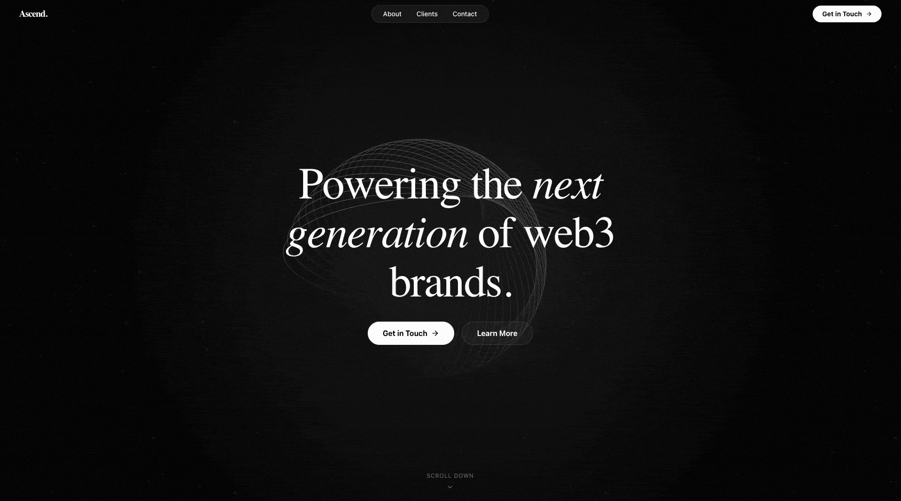

<h1 align="center">Ascend.</h1>

<p align="center">
  A cinematic, motion-driven landing page for a Web3 marketing agency helping blockchain brands grow.
</p>

<p align="center">
  
  
  
  
</p>

<p align="center">
  <a href="#overview">Overview</a>
  ·
  <a href="#getting-started">Getting Started</a>
  ·
  <a href="#page-sections">Page Sections</a>
  ·
  <a href="#deployment">Deployment</a>
</p>

<br />

<p align="center">
  
</p>

## Overview

Ascend. is a single-page Web3 agency website built around smooth scrolling, editorial typography, and scroll-reactive abstract graphics. It presents an agency positioning statement, service narrative, client showcase, contact calls to action, and footer navigation.

The page includes:

- Animated navigation and responsive mobile layout
- Full-screen hero with primary and secondary calls to action
- Scroll-triggered agency positioning sections
- A fixed SVG coil that rotates, scales, and moves with page progress
- A second geometric orb/prism visual revealed in the clients section
- Client grid featuring Web3 companies and icon-based visual identities
- Contact-focused CTA and footer with social links
- Lenis smooth scrolling with Motion spring interpolation

## Tech stack

- **React 19 + TypeScript** — UI composition and type-safe page components
- **Vite 6** — development server and production builds
- **Motion** — entrance, viewport, transform, and spring animations
- **Lenis** — smooth scrolling and scroll interpolation
- **Tailwind CSS** — utility classes and responsive layout
- **Lucide React** — navigation, client, and social icons
- **SVG** — lightweight abstract scroll visuals

## Requirements

- Node.js (an active LTS release)
- npm
- A modern browser with JavaScript enabled

## Getting started

### 1. Install dependencies

```bash
npm install
```

### 2. Start the development server

```bash
npm run dev
```

Vite will print the local URL in the terminal, usually `http://localhost:5173`.

### 3. Create a production build

```bash
npm run build
```

### 4. Preview the production build

```bash
npm run preview
```

## Available scripts

| Command | Description |
| --- | --- |
| `npm run dev` | Start the Vite development server |
| `npm run build` | Build the production bundle |
| `npm run preview` | Preview the production bundle locally |
| `npm run lint` | Run the TypeScript compiler without emitting files |

## Project structure

```text
.
├── public/                    # Optional static assets
├── src/
│   ├── App.tsx               # Navigation, sections, visuals, and footer
│   ├── index.css             # Theme, typography, glass effects, and scrollbar rules
│   └── main.tsx              # React entry point
├── index.html                # HTML shell and document metadata
├── package.json               # Scripts and dependencies
├── tsconfig.json              # TypeScript configuration
└── vite.config.ts             # Vite and Tailwind configuration
```

## Page sections

1. **Navigation** — brand, section links, and contact action
2. **Hero** — Web3 agency positioning and introductory actions
3. **Strategy** — decentralized-world marketing capabilities
4. **Growth** — blockchain, crypto, NFT, and DeFi project focus
5. **Clients** — client grid with hover states and supporting CTA
6. **CTA** — invitation to start a Web3 project conversation
7. **Footer** — contact email, social links, discovery links, and copyright

## Customization

### Content and client list

All page sections, copy, client names, navigation items, contact details, and footer links are currently composed in [`src/App.tsx`](src/App.tsx). Replace placeholder links and the `contact@example.xyz` address before production use.

### Scroll visuals

The `ScrollVisual` component in [`src/App.tsx`](src/App.tsx) controls the fixed SVG coil and orb/prism. Adjust the Motion `useTransform` ranges to change when each visual appears, how far it moves, and how quickly it rotates.

### Theme

Global colors, typography, glass panels, gradients, and smooth-scroll helper classes are defined in [`src/index.css`](src/index.css).

## Current integration notes

- The site is a static marketing experience with no CMS, form submission endpoint, analytics, or authentication.
- Navigation, social, and CTA buttons use placeholder `#` links unless otherwise noted.
- The contact email is an example address and must be replaced with a real business inbox.
- Client names and statistics are presentation content, not data loaded from an API.
- The Vite template exposes `GEMINI_API_KEY`, but the current page does not call a Gemini or other external API.

## Quality checks

```bash
npm run lint
npm run build
```

## Deployment

Ascend. is a static Vite application and can be deployed to Vercel, Netlify, GitHub Pages, or another static hosting provider.

| Setting | Value |
| --- | --- |
| Install command | `npm install` |
| Build command | `npm run build` |
| Output directory | `dist` |

Configure the Vite `base` option in [`vite.config.ts`](vite.config.ts) when hosting from a subpath.

## License

No license has been declared for this project yet. Add a `LICENSE` file before public distribution.
